  

 

Oi, eu sou o **Barney** (João Leonardo), do Rio de Janeiro.
Crio interfaces, aplicativos e coisas para o Discord: código, curiosidade e ideias que vão ganhando forma.

- **Portfólio:** [eqp.wtf](https://eqp.wtf)
- **Comunidade:** [discord.gg/eqp](https://discord.gg/eqp)
- **Fora do código:** anime, jogos e IA

### Com o que eu trabalho

  

### Em destaque

- **[eqp.wtf](https://eqp.wtf)**: meu espaço pessoal. Abertura com a minha assinatura, um quarto 3D, uma personagem 3D com física de cabelo e roupa que reage ao meu status no Discord, e o Discord ao vivo no site.

### Onde me achar

